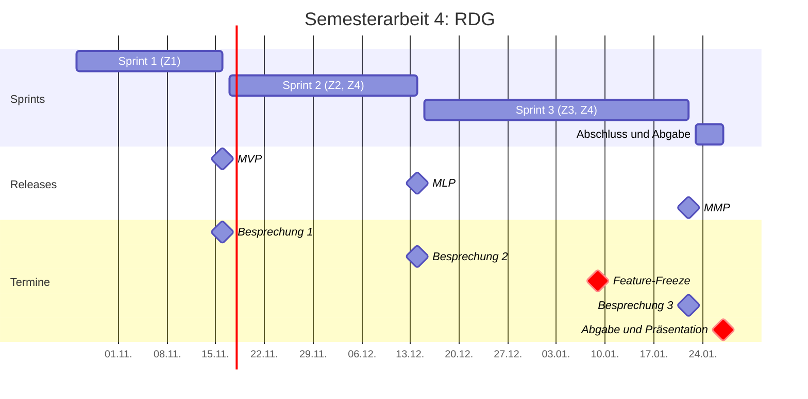

# Roadmap

Die Roadmap folgt den Releases MVP, MLP und MMP, wie es die TBZ für Semesterarbeiten empfiehlt. Jeder Sprint endet mit einem Release, danach folgen Review und Retrospektive.

| Release | Ende | Was der Release bringt |
| --- | --- | --- |
| MVP | Sprint 1, 16.11.2026 | RDG liegt sauber auf GitHub, Board steht, Branch-Schutz aktiv, CI-Pipeline läuft grün (Z1) |
| MLP | Sprint 2, 14.12.2026 | Jeder Merge deployt automatisch in die Testumgebung, Release nur nach Freigabe (Z2). Erste KI-Pipeline mit Sicherheitsregeln (Z4) |
| MMP | Sprint 3, 22.01.2027 | KI-Pipeline für vier Issue-Arten, 8 Test-Issues ausgewertet, Prompt-Injection-Test (Z3, Z4) |

## Zeitplan

## Feature-Freeze

Ab dem 09.01.2027 kommen keine neuen Funktionen mehr dazu. Die Zeit bis zur Abgabe ist für Tests, Fehlerbehebung, Auswertung und Dokumentation reserviert.
