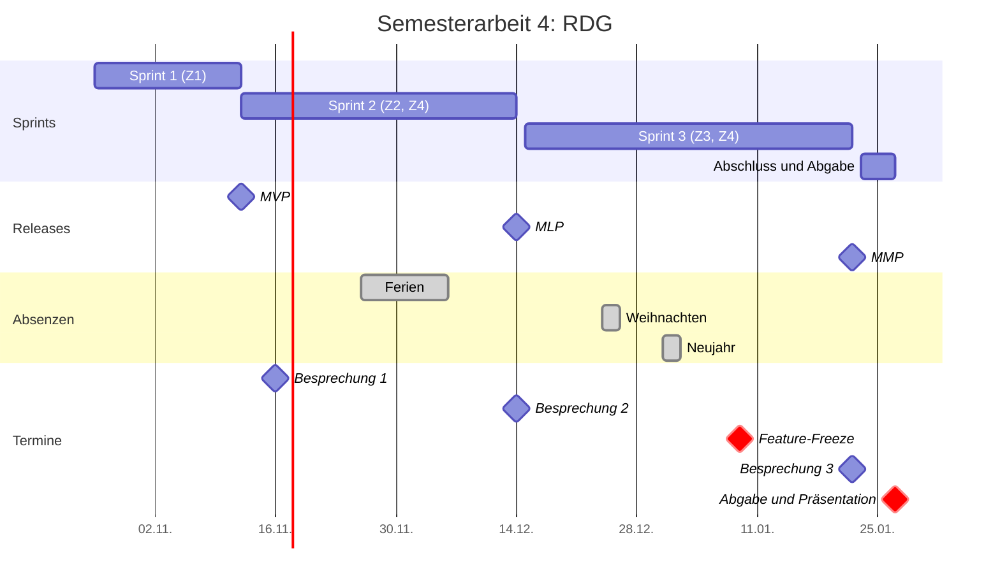
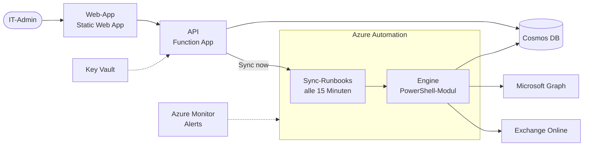
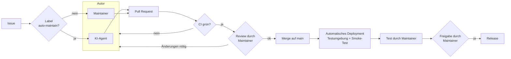

# Projektdokumentation

| | |
| :--- | :--- |
| Titel der Semesterarbeit | RDG als DevOps-Projekt mit KI-Wartung: Eine Pipeline, die GitHub-Issues selbst löst |
| Name | Dodoe Rumiñahui Mannale |
| Studiengang | Dipl. Informatiker/in HF, ITCNE25, TBZ |
| Semester / Abgabe | Semester 4 / 27.01.2027 |
| Themenfelder | Projektmanagement, DevOps |

Diese Projektdokumentation besteht aus **Teil A Projektmanagement** (Kapitel 1 bis 6) und **Teil B fachliche Umsetzung** (Kapitel 7 bis 13), gefolgt vom gemeinsamen **Anhang** (Kapitel 14). Sie wird während der Arbeit laufend ergänzt. Details liegen in den verlinkten Seiten dieser Doku, im [Kanban-Board](https://github.com/users/RuminahuiM/projects/1) und im Produkt-Repository [RuminahuiM/rdg](https://github.com/RuminahuiM/rdg).

!!! info "Stand 08.11.2026"
    Gerüst mit allen Kapiteln. Was schon feststeht, ist ausgefüllt. Kapitel mit dem Hinweis "Folgt" werden im genannten Sprint ergänzt.

## Inhaltsverzeichnis

**Teil A: Projektmanagement**

1. [Einleitung](#1-einleitung)
2. [Projektmethodik](#2-projektmethodik)
3. [Planung](#3-planung)
4. [Durchführung](#4-durchfuhrung)
5. [Risikomanagement](#5-risikomanagement)
6. [Reflexion Projektmanagement](#6-reflexion-projektmanagement)

**Teil B: Fachliche Umsetzung**

7. [Fachlicher Kontext und Theorie](#7-fachlicher-kontext-und-theorie)
8. [Anforderungen](#8-anforderungen)
9. [Architektur und Design](#9-architektur-und-design)
10. [Umsetzung](#10-umsetzung)
11. [Test und Qualitätssicherung](#11-test-und-qualitatssicherung)
12. [Ergebnis und Abnahme](#12-ergebnis-und-abnahme)
13. [Reflexion fachlich](#13-reflexion-fachlich)

**Anhang**

14. [Anhang und Verzeichnisse](#14-anhang-und-verzeichnisse)

## Zusammenfassung

!!! info "Folgt am Schluss"
    Kurze Zusammenfassung auf einer halben Seite: Ausgangslage, Vorgehen, wichtigste Ergebnisse pro Ziel, Fazit der KI-Auswertung.

---

## Teil A: Projektmanagement

## 1. Einleitung

### 1.1 Ausgangslage und Problemstellung

In Microsoft 365 gibt es dynamische Gruppen, die ihre Mitglieder automatisch nach Regeln füllen. In der Praxis reichen sie oft nicht: Viele Funktionen akzeptieren keine dynamischen Gruppen (z.B. mail-aktivierte Gruppen, Verteilerlisten oder gewisse Defender- und Exchange-Richtlinien), man kann Regel und manuelle Ausnahmen nicht mischen, und die Regel-Möglichkeiten sind begrenzt. Darum habe ich bei meiner Arbeit das Tool RDG (Real Dynamic Groups) gebaut. RDG wertet die Regeln selbst aus und schreibt das Resultat als normale Mitgliederliste in die Gruppe.

RDG ist bisher ein MVP. Es läuft in Azure und wird beim ersten Anwender getestet. Die Pipelines sind angelegt, aber nie richtig getestet, und das Deployment mache ich von Hand von meinem PC aus. Dazu kommt: Ich werde die Firma voraussichtlich bald verlassen, und danach pflegt niemand RDG weiter.

Ich möchte RDG darum als Open-Source-Projekt veröffentlichen, das möglichst wenig Wartung von Hand braucht. Zuerst setze ich es sauber als DevOps-Projekt auf. Danach probiere ich aus, wie gut ein KI-Agent bei der Wartung helfen kann, und werte das aus.

### 1.2 Project Summary

!!! info "Folgt am Schluss"
    Kurzer Überblick über das ganze Projekt: was gemacht wurde, mit welchen Mitteln, mit welchem Ergebnis.

### 1.3 Stakeholder

| Stakeholder | Rolle | Interesse |
| --- | --- | --- |
| Ich (Studierender) | Product Owner, Scrum Master, Developer | Erfolgreiche Semesterarbeit, RDG langfristig wartbar machen |
| Corrado Parisi | Experte Projektmanagement | Sauberes agiles Vorgehen, nachvollziehbare Planung und Steuerung |
| Thanam Pangri | Experte DevOps (Fachexperte) | Fachlich korrekte Umsetzung von CI/CD, Deployment und KI-Pipeline |
| Erster Anwender von RDG (mein Arbeitgeber) | Kunde | RDG weiter nutzen können, auch ohne mich |
| Open-Source-Community | spätere Nutzer und Mitwirkende | Verständliches, sicheres und gepflegtes Tool |

*Tabelle 1: Stakeholder*

### 1.4 Ziele (SMART)

| Ziel | Beschreibung | Messgrösse (Nachweis) | Termin | Umfang |
| --- | --- | --- | --- | --- |
| Z1 | Sauberes DevOps-Projekt: Repository mit Branching-Strategie, Kanban-Board, SemVer, Merge nur per Pull Request mit grüner CI | Ein absichtlich fehlerhafter Pull Request wird blockiert | 16.11.2026 | Must |
| Z2 | Automatisches Deployment in die Testumgebung (mit Smoke-Test) und Release-Freigabe von Hand | Mindestens 5 automatische Deployments, mindestens ein freigegebenes Release | 14.12.2026 | Must |
| Z3 | KI-Wartung als Versuch mit vier Issue-Arten | Auswertung von 8 Test-Issues: Ergebnis, eigener Aufwand, Dauer, Kosten | 22.01.2027 | Must (Durchführung und Auswertung) |
| Z4 | Die KI bleibt eingeschränkt: nur Pull Requests, kein Zugriff auf Umgebungen, nur meine Issues | Prompt-Injection-Test führt zu keiner unerlaubten Aktion | 22.01.2027 | Must |

*Tabelle 2: Ziele*

### 1.5 Scope und Abgrenzung

| In Scope | Out of Scope |
| --- | --- |
| RDG als DevOps-Projekt aufnehmen: Repository, Arbeitsregeln, Tests, Doku | Neue Funktionen von RDG selbst |
| Alle Pipelines (CI, Deployment, Release), auch die bestehenden | Kubernetes (Ausnahme für diese Arbeit, abgesprochen am 21.10.2026; folgt in der 5. Semesterarbeit) |
| KI-Pipeline für vier Issue-Arten mit Auswertung | Weitere Issue-Arten und ein KI-Helfer in der Web-App (optional) |
| Testumgebung im eigenen Tenant (Rumi Designs) | Änderungen an der produktiven Installation beim ersten Anwender |

*Tabelle 3: Scope*

## 2. Projektmethodik

### 2.1 Warum Scrum

Ich arbeite mit Scrum, weil ich möglichst viel Übung im agilen Arbeiten sammeln will. In einem DevOps-Team ist ein agiles Vorgehen wie Scrum üblich, darum wende ich es hier so realistisch wie möglich an.

Ehrlich gesagt ist Scrum für einen Solo-Entwickler nicht die praktischste Wahl. Rollen, Events und Artefakte sind für Teams gedacht, und einiges davon wirkt allein künstlich. Für mich allein hätte wohl auch ein einfaches Kanban gereicht. Ich nehme den Mehraufwand bewusst in Kauf und prüfe in den Retrospektiven, welche Teile auch allein helfen und welche nicht (siehe Kapitel 6.1). Gut passt, dass die drei festen Besprechungen der TBZ als Sprint-Enden dienen: Nach jedem Sprint zeige ich einen lauffähigen Stand und hole Feedback ab.

Innerhalb eines Sprints nutze ich das Board in GitHub Projects wie ein Kanban-Board, damit ich sehe, wo jede Story steht und was blockiert ist.

### 2.2 Scrum in der Solo-Anwendung

Ich übernehme alle drei Verantwortlichkeiten (Product Owner, Scrum Master, Developer). Wie ich Events, Artefakte und die Grenzen der Solo-Anwendung handhabe, steht im [Scrum-Setup](projekt/scrum-setup.md).

### 2.3 User Stories, Akzeptanzkriterien, Definition of Ready und Done

Jede Story ist ein Issue mit Akzeptanzkriterien als Checkliste. Ein Item wechselt im Board erst von Backlog zu ToDo, wenn es die Definition of Ready erfüllt. Definition of Ready und Definition of Done stehen im [Scrum-Setup](projekt/scrum-setup.md#definition-of-ready).

### 2.4 Schätzung und Priorisierung

Schätzung mit Story Points nach Fibonacci, Priorisierung nach MoSCoW (Labels `must`, `should`, `could`, `wont`).

### 2.5 Werkzeuge

| Werkzeug | Wofür |
| --- | --- |
| GitHub Projects | Kanban-Board, Product Backlog, Sprint-Übersicht |
| GitHub (zwei Repositories) | Produkt-Code (`rdg`) und Projektdokumentation (`rdg-semesterarbeit`) |
| GitHub Actions | CI, Deployment, Release, KI-Pipeline, Veröffentlichung dieser Doku |
| GitHub Pages mit Material for MkDocs | Veröffentlichung dieser Dokumentation |
| MS Teams | Kommunikation mit den Experten |
| Claude (Anthropic) | KI-Agent in der Pipeline (Gegenstand der Arbeit) und KI-Assistent bei der Arbeit (siehe [Deklaration](#141-deklaration-der-ki-nutzung)) |

*Tabelle 4: Werkzeuge*

### 2.6 Arbeiten mit KI-Unterstützung

KI kommt in dieser Arbeit auf zwei Arten vor:

1. **Als Gegenstand der Arbeit:** Ein KI-Agent soll in der Pipeline Issues bearbeiten (Z3), mit klaren Grenzen (Z4).
2. **Als Assistent bei meiner Arbeit:** Ich nutze Claude beim Planen, Recherchieren, Schreiben und Programmieren.

Für den zweiten Punkt gelten feste Regeln: Ich prüfe alle Ergebnisse selbst, Änderungen am Code laufen wie alle anderen über Pull Request und CI, und ich verantworte alles, was abgegeben wird. Die Deklaration steht in [Kapitel 14.1](#141-deklaration-der-ki-nutzung).

Um den Effekt sichtbar zu machen, vergleiche ich pro Story die Schätzung (Story Points, als Richtwert ohne KI in Stunden umgerechnet) mit der tatsächlich gebrauchten Zeit aus dem Daily Journal. Die Auswertung folgt in Kapitel 6.

## 3. Planung

### 3.1 Roadmap und Releases

| Release | Ende | Was der Release bringt |
| --- | --- | --- |
| MVP | Sprint 1, 12.11.2026 (geplant 16.11.) | RDG liegt sauber auf GitHub, Board steht, Branch-Schutz aktiv, CI-Pipeline grün (Z1) |
| MLP | Sprint 2, 14.12.2026 | Automatisches Deployment in die Testumgebung, Release nur nach Freigabe (Z2), erste KI-Pipeline mit Sicherheitsregeln (Z4) |
| MMP | Sprint 3, 22.01.2027 | KI-Pipeline für vier Issue-Arten, 8 Test-Issues ausgewertet, Prompt-Injection-Test (Z3, Z4) |

*Tabelle 5: Releases*

### 3.2 Gantt-Chart

*Abbildung 1: Gantt-Chart mit Sprints, Releases, Absenzen und Terminen*

Ab dem **Feature-Freeze am 09.01.2027** kommen keine neuen Funktionen mehr dazu. Die Zeit bis zur Abgabe ist für Tests, Fehlerbehebung, Auswertung und Dokumentation reserviert.

### 3.3 Product Backlog

Der Backlog liegt im [Kanban-Board](https://github.com/users/RuminahuiM/projects/1). Pro Ziel gibt es ein Epic, die Stories hängen als Unter-Issues daran.

| Epic | Kürzel | Ziel |
| --- | --- | --- |
| Projektmanagement und Kommunikation | PM | |
| Sauberes DevOps-Projekt | CI | Z1 |
| Automatisches Deployment und Release-Freigabe | DEP | Z2 |
| Die KI bleibt eingeschränkt | SEC | Z4 |
| KI-Wartung als Versuch | AI | Z3 |
| Dokumentation und Abschluss | DOC | |

*Tabelle 6: Epics*

### 3.4 Kapazität und Sprint-Kalender

Gearbeitet wird am Samstag und Sonntag (je ca. 5 h) und am Mittwoch (mindestens ca. 4 h). Nicht gearbeitet wird in den Ferien vom 26.11. bis 06.12.2026, an Weihnachten (24. bis 26.12.) und über Neujahr (31.12. bis 02.01.). Pro Sprint plane ich ca. 20 Prozent Reserve ein. Die TBZ gibt ca. 50 Stunden als Richtwert vor, meine Kapazität liegt deutlich darüber.

| Abschnitt | Arbeitstage | Kapazität | davon planbar (80 %) |
| --- | --- | --- | --- |
| Sprint 1 (ab Start der Umsetzung am 07.11., abgeschlossen am 12.11.) | Sa 07.11., So 08.11., Mi 11.11., Do 12.11. | tatsächlich ca. 16 h | |
| Sprint 2 (ab 12.11.) | Sa 14.11., So 15.11., Mi 18.11., Sa 21.11., So 22.11., Mi 25.11., Mi 09.12., Sa 12.12., So 13.12. | ca. 42 h | ca. 33.5 h |
| Sprint 3 bis Feature-Freeze | Mi 16.12., Sa 19.12., So 20.12., Mi 23.12., So 27.12., Mi 30.12., So 03.01., Mi 06.01. | ca. 36 h | ca. 29 h |
| Sprint 3 nach Feature-Freeze | Sa 09.01., So 10.01., Mi 13.01., Sa 16.01., So 17.01., Mi 20.01. | ca. 28 h | Tests, Auswertung, Doku |
| Abschluss | Sa 23.01., So 24.01., Mi 27.01. | ca. 14 h | Präsentation, Abgabe |

*Tabelle 15: Sprint-Kalender mit echten Arbeitstagen*

Sprint 1 war am 12.11. fertig und wurde vorzeitig abgeschlossen. Sprint 2 beginnt dadurch schon am 12.11. und bekommt die Arbeitstage 14. und 15.11. dazu. Die Ferien vom 26.11. bis 06.12. bleiben trotzdem eine Lücke mitten im Sprint (R-S01).

### 3.5 SWOT-Analyse

| | Hilfreich | Hinderlich |
| --- | --- | --- |
| **Intern** | **Stärken:** RDG existiert als funktionierendes MVP mit Tests, Mocks und Pipelines; ich kenne das Tool und das Umfeld genau | **Schwächen:** Solo-Projekt ohne Code-Review durch eine zweite Person; begrenzte Zeit neben Beruf und Schule |
| **Extern** | **Chancen:** KI-Agenten in CI/CD sind 2026 verfügbar und gut dokumentiert; Open Source macht RDG für andere nutzbar | **Risiken:** KI-Ergebnisse schwer vorhersehbar; Test-Tenant und Azure kosten Geld; Abhängigkeit von externen Diensten (GitHub, Azure, Anthropic) |

*Tabelle 7: SWOT-Analyse (Stand 07.11.2026)*

## 4. Durchführung

### 4.1 Sprint 1: Sauberes DevOps-Projekt

**Ziel:** RDG liegt sauber auf GitHub, Board steht, Branch-Schutz aktiv, CI-Pipeline grün (Z1). **Ergebnis:** vollständig erreicht, alle 25 Story Points erledigt, Release MVP.

Sprint 1 startete laut Ablaufplan am 26.10., die Umsetzung aber erst am 07.11., weil das Einreichungsformular zuerst überarbeitet werden musste. In vier Arbeitstagen entstanden das Projekt-Setup (Doku, Board, Backlog), die Lizenz, die Arbeitsregeln, die reparierte CI-Pipeline und der Branch-Schutz. Die CI-Reparatur war grösser als erwartet (4 von 6 Jobs rot, siehe [Kapitel 10.2](#102-ci-pipeline-z1)), dank KI-Unterstützung aber schneller erledigt als geschätzt. Weil alle Stories am 12.11. fertig waren, habe ich den Sprint vier Tage früher abgeschlossen.

Die wichtigste Erkenntnis aus der Retrospektive: Die Experten habe ich zu Beginn zu lange auf eine Antwort warten lassen. Für Sprint 2 gilt darum, Rückmeldungen innerhalb von zwei Tagen zu beantworten. Details im [Review](sprints/sprint-1/review.md) und in der [Retrospektive](sprints/sprint-1/retro.md).

### 4.2 Sprint 2: Deployment, Release und erste KI-Pipeline

!!! info "Folgt nach Sprint 2"

### 4.3 Sprint 3: KI-Wartung als Versuch

!!! info "Folgt nach Sprint 3"

### 4.4 Fortschritt: Velocity und Burn-up

| Sprint | Geplante SP | Erledigte SP | Geschätzte Stunden (ohne KI) | Tatsächliche Stunden |
| --- | --- | --- | --- | --- |
| 1 | 25 | 25 | 27 | 16 |
| 2 | folgt | | | |
| 3 | folgt | | | |

*Tabelle 24: Velocity pro Sprint*

Die tatsächliche Zeit lag in Sprint 1 bei ca. 60 Prozent der Schätzung. Ein Burn-up-Chart folgt, sobald zwei Sprints vorliegen.

### 4.5 Kommunikation mit den Experten

| Datum | Mit | Thema | Ergebnis |
| --- | --- | --- | --- |
| 21.10.2026 | Thanam Pangri, Marcel Bernet | Kubernetes-Vorgabe | Ausnahme für diese Arbeit |
| 07.11.2026 | Corrado Parisi | Feedback zum Einreichungsformular | Formular überarbeitet (Version 2) und gesendet, Freigabe ausstehend |
| 08.11.2026 | Alle Experten | Zwischenstand mit Links | Gepostet, Zuteilung Fachexperte DevOps offen |
| 09.11.2026 | Corrado Parisi, Thanam Pangri | Freigabe des Formulars (Version 2) und fachliche Betreuung | Formular freigegeben ohne Auflagen; Thanam Pangri betreut die Arbeit fachlich |
| 12.11.2026 | Corrado Parisi, Thanam Pangri | Sprint 1 Review und Vorbereitung von Besprechung 1 | Gepostet, Doku zur Durchsicht vor dem Termin |

*Tabelle 8: Abstimmungen mit den Experten*

Weitere Details unter [Besprechungen](besprechungen/index.md).

## 5. Risikomanagement

### 5.1 Methodik

Risiken werden nach Wahrscheinlichkeit und Auswirkung (je 1 bis 3) bewertet, der Score ist das Produkt. Ab Score 4 wird ein Risiko aktiv beobachtet, ab Score 6 hat es hohe Priorität. Jedes Risiko hat eine vorbeugende Massnahme und einen Plan B. Das ganze Register steht im [Risk Register](projekt/risk-register.md).

### 5.2 Wichtigste Risiken und Massnahmen

| ID | Risiko | Score | Massnahme |
| --- | --- | --- | --- |
| R-T01 | Die KI macht falsche Änderungen | 6 | CI-Pipeline, Prüfung jedes Pull Requests, Test vor dem Release |
| R-T02 | Prompt Injection oder zu viele Rechte für den Agenten | 6 | Nur meine Issues, minimale Rechte, kein Zugriff auf Umgebungen, eigener Test |
| R-K01 | Der KI-Teil ist schwieriger als gedacht | 6 | Z1 und Z2 zuerst, vier klar begrenzte Issue-Arten |
| R-E01 | Testumgebung nicht rechtzeitig verfügbar | 6 | Test-Tenant zu Beginn von Sprint 2, Mocks als Plan B |
| R-S01 | Sprints laufen über, besonders Sprint 2 wegen der Ferien | 9 | 20 Prozent Reserve, MoSCoW, Should- und Could-Stories zuerst streichen, Umfang von Sprint 2 im Planning bewusst klein halten |
| R-S02 | Zu wenig Zeit für Doku am Schluss | 6 | Feature-Freeze 09.01.2027, Doku laufend in jedem Sprint |

*Tabelle 9: Risiken mit hoher Priorität (Stand 07.11.2026)*

### 5.3 Eingetretene Risiken und Reaktion

| Risiko | Was passiert ist | Reaktion |
| --- | --- | --- |
| R-T03 Pipelines brauchen mehr Arbeit | Die CI war seit dem Import rot, 4 von 6 Jobs, beim Engine-Job mit vier unabhängigen Ursachen (siehe 10.2) | Ein Pull Request pro Job, Diagnose direkt auf dem Runner. Alle Jobs grün am 11.11.2026, drei Tage früher als geplant |

*Tabelle 22: Eingetretene Risiken*

## 6. Reflexion Projektmanagement

### 6.1 Solo-Scrum: was trug und was fehlte

!!! info "Folgt am Schluss"

### 6.2 Planung, Schätzung und Zeit

!!! info "Folgt am Schluss"

### 6.3 Handlungsempfehlungen

!!! info "Folgt am Schluss"

---

## Teil B: Fachliche Umsetzung

## 7. Fachlicher Kontext und Theorie

### 7.1 RDG kurz erklärt

RDG (Real Dynamic Groups) pflegt die Mitglieder von Microsoft-365-Gruppen nach Regeln. Die Regeln schreibt man in derselben Syntax wie bei dynamischen Gruppen in Entra ID. RDG wertet sie regelmässig aus und schreibt das Resultat als normale, statische Mitglieder in die Gruppe. Dadurch funktioniert die Gruppe überall, wo eine statische Gruppe funktioniert, zum Beispiel als Empfänger in Defender-Richtlinien oder als Verteilerliste.

Was RDG kann:

- **Gruppen erstellen oder übernehmen:** Eine Definition kann eine neue Gruppe anlegen oder eine bestehende Gruppe übernehmen (adopt). RDG pflegt die Gruppe danach weiter, mit derselben Gruppen-ID und Mailadresse, sodass bestehende Verweise weiter funktionieren.
- **Alle Gruppentypen:** Sicherheitsgruppen, Microsoft-365-Gruppen, mail-aktivierte Sicherheitsgruppen und Verteilerlisten.
- **Regeleditor:** Die Regel wird schon beim Tippen geprüft, mit demselben Parser, den auch die Engine verwendet.
- **Manuelle Ausnahmen:** Einzelne Personen lassen sich fix hinzufügen oder ausschliessen, zusätzlich zur Regel.
- **Vorschau:** Zeigt, wer im Moment zur Regel passt und was sich an der Gruppe ändern würde.
- **Schutz vor Fehlern:** Im Modus DryRun zeichnet RDG Änderungen nur auf, ohne sie auszuführen. Ändert sich ein Lauf mehr als einen eingestellten Prozentsatz der Mitglieder, wartet RDG auf eine Freigabe durch einen Admin.
- **Bedienung und Nachvollziehbarkeit:** Sync per Knopfdruck ("Sync now"), Übersicht über die Aktivität aller Gruppen, Audit-Trail (wer hat wann was geändert) und zwei Rollen (Admin und Reader).

RDG besteht aus einer Engine (PowerShell in Azure Automation), einer API (Azure Functions), einer Web-App (React, Azure Static Web Apps) und einer Datenbank (Cosmos DB). Die Infrastruktur wird mit OpenTofu beschrieben und im Tenant des Anwenders installiert (siehe [Kapitel 9.1](#91-ausgangslage-architektur-von-rdg)).

### 7.2 DevOps, CI/CD und Continuous Delivery

DevOps bringt Entwicklung und Betrieb zusammen: Änderungen sollen klein, häufig und sicher in Betrieb gehen. Zwei Bausteine sind dafür zentral:

- **Continuous Integration (CI):** Jede Änderung wird automatisch gebaut und getestet, bevor sie in den Hauptstand kommt. Bei RDG prüft die CI-Pipeline Linting, Unit-Tests, Verträge der API, die Infrastruktur und Sicherheitsregeln (siehe [Kapitel 11.1](#111-teststrategie)).
- **Continuous Delivery (CD):** Jeder geprüfte Stand kann jederzeit ausgeliefert werden. Bei RDG heisst das: Jeder Merge auf `main` landet automatisch in der Testumgebung (Z2). Ein Release für Anwender entsteht aber erst nach einer Freigabe von Hand. Das ist der Unterschied zu Continuous Deployment, wo jede Änderung ohne Freigabe in Produktion geht.

Wie gut eine Auslieferung funktioniert, misst die DORA-Forschung mit fünf Kennzahlen: Change Lead Time, Deployment Frequency, Failed Deployment Recovery Time, Change Fail Rate und Deployment Rework Rate.[^dora] Für diese Arbeit sind vor allem die Deployment Frequency und die Change Lead Time interessant, weil sie zeigen, wie schnell eine Änderung (auch vom KI-Agenten) in der Testumgebung ankommt.

### 7.3 GitHub Flow, Conventional Commits und SemVer

- **GitHub Flow:** Für jede Änderung ein kurzer Branch von `main`, dann ein Pull Request, Prüfung, Merge und Löschen des Branches.[^flow] `main` ist immer lauffähig. Für ein kleines Projekt ohne parallele Release-Linien ist das einfacher als Git Flow. Der Entscheid ist in Story CI-3 als [ADR 0003](https://github.com/RuminahuiM/rdg/blob/main/docs/adr/0003-branching-github-flow.md) festgehalten.
- **Conventional Commits:** Commit-Nachrichten haben eine feste Form wie `feat: ...`, `fix: ...` oder `docs: ...`.[^cc] So kann man aus der Historie ablesen, was sich geändert hat, und die nächste Versionsnummer ableiten.
- **Semantic Versioning (SemVer):** Versionen haben die Form `MAJOR.MINOR.PATCH`.[^semver] MAJOR steigt bei inkompatiblen Änderungen, MINOR bei neuen Funktionen, PATCH bei Fehlerkorrekturen. Vorabversionen wie `0.1.0-eval.4` sind erlaubt und zeigen, dass RDG noch nicht stabil ist.

### 7.4 Infrastructure as Code mit OpenTofu

Bei Infrastructure as Code wird die Infrastruktur als Code beschrieben, versioniert und automatisch ausgerollt, statt sie von Hand im Portal anzulegen. RDG nutzt dafür OpenTofu, die Open-Source-Variante von Terraform. Ein `plan` zeigt vor jeder Änderung, was passieren würde, ein `apply` setzt es um. In der CI-Pipeline wird die Konfiguration mit einem gemockten Provider getestet (`tofu test`), also ohne echte Azure-Ressourcen.

### 7.5 KI-Agenten in der Softwarewartung

Ein KI-Agent ist ein Sprachmodell, das nicht nur Text erzeugt, sondern in mehreren Schritten Werkzeuge benutzt: Dateien lesen, Code ändern, Tests ausführen und einen Pull Request erstellen. In GitHub Actions kann ein solcher Agent durch ein Ereignis gestartet werden, zum Beispiel durch ein Issue mit einem bestimmten Label.[^agent]

Die Ergebnisse eines Agenten sind nicht vorhersehbar: Er kann eine Aufgabe sauber lösen, nur teilweise lösen oder etwas Falsches mit grosser Überzeugung vorschlagen. Darum bleibt in dieser Arbeit ein Mensch an zwei Stellen in der Schleife (Human in the Loop): beim Review des Pull Requests und bei der Freigabe des Releases. Was der Agent konkret kann und wo er scheitert, ist genau die Frage von Z3.

Für die Kosten ist wichtig, wie sich der Agent anmeldet. Die Claude-Code-Action kann sich mit einem API-Key (Abrechnung pro Token) oder mit einem OAuth-Token aus einem Claude-Abo anmelden. Mit dem Token laufen die Durchläufe über das Abo statt über die API-Abrechnung.[^gha] Die Durchläufe teilen sich dann aber die Limits mit meiner normalen Nutzung des Abos. Ob das im Alltag reicht und stabil läuft, prüfe ich in Sprint 2 (Story AI-9).

!!! info "Wird mit den ersten Versuchen in Sprint 2 vertieft"

### 7.6 Sicherheit: Least Privilege, OIDC und Prompt Injection

- **Least Privilege:** Jede Komponente bekommt nur die Rechte, die sie wirklich braucht. Für den Agenten heisst das: Er darf einen Branch und einen Pull Request erstellen, aber nicht auf `main` pushen und nicht auf Azure zugreifen (Z4).
- **OIDC statt Secrets:** Mit OpenID Connect holt sich ein Workflow für jeden Lauf ein kurzlebiges Token von Azure. Es gibt kein langlebiges Passwort, das gestohlen werden könnte.[^oidc] Welcher Workflow ein Token bekommt, legt eine Vertrauensregel in Azure fest (z.B. nur `main` oder nur eine bestimmte Umgebung).
- **Prompt Injection:** Ein Angreifer versteckt Anweisungen in einem Text, den das Modell liest, zum Beispiel in einem Issue. Die OWASP Top 10 für LLM-Anwendungen führen das als grösstes Risiko (LLM01), zusammen mit "Excessive Agency" (LLM06), also zu vielen Rechten für ein Modell.[^owasp] Gegenmassnahmen sind genau die Grenzen aus Z4: nur Issues von mir, minimale Rechte, Prüfung durch einen Menschen. Ein eigener Test prüft das (T-07 im [Testprotokoll](nachweise/testprotokoll.md)).

Eine Idee, die ich als optionale Story prüfe (SEC-5): Statt dass Issues direkt an den Agenten gehen, nimmt ein KI-Chat die Anliegen entgegen und erstellt daraus ein sauberes Issue nach Vorlage. Das ähnelt dem "Dual LLM"-Muster: Ein Modell liest den unsicheren Text, hat aber keine gefährlichen Rechte, und nur sein strukturiertes Ergebnis geht weiter.[^dual] Ganz verhindern lässt sich Prompt Injection so nicht, weil auch der Chat den Text des Angreifers liest. Der mögliche Schaden wird aber kleiner.

[^dora]: DORA, "DORA's software delivery performance metrics", <https://dora.dev/guides/dora-metrics-four-keys>, Zugriff 08.11.2026.
[^flow]: GitHub Docs, "GitHub flow", <https://docs.github.com/en/get-started/using-github/github-flow>, Zugriff 08.11.2026.
[^cc]: Conventional Commits 1.0.0, <https://www.conventionalcommits.org/en/v1.0.0/>, Zugriff 08.11.2026.
[^semver]: Semantic Versioning 2.0.0, <https://semver.org/>, Zugriff 08.11.2026.
[^agent]: Background Claude, "Claude Code in GitHub Actions: the v1 recipe, with guardrails", <https://backgroundclaude.com/blog/github-actions>, Zugriff 07.11.2026.
[^oidc]: GitHub Docs, "Configuring OpenID Connect in Azure", <https://docs.github.com/en/actions/how-tos/secure-your-work/security-harden-deployments/oidc-in-azure>, Zugriff 08.11.2026.
[^gha]: Anthropic, "Claude Code GitHub Actions", <https://code.claude.com/docs/en/github-actions>, Zugriff 08.11.2026.
[^dual]: Simon Willison, "The Dual LLM pattern for building AI assistants that can resist prompt injection", <https://simonwillison.net/2023/Apr/25/dual-llm-pattern/>, Zugriff 08.11.2026.
[^owasp]: PointGuard AI, "Understanding the 2025 OWASP Top 10 for LLM Applications", <https://www.pointguardai.com/blog/understanding-the-owasp-top-10-for-llms>, Zugriff 08.11.2026.

## 8. Anforderungen

Die Anforderungen leiten sich aus den Zielen Z1 bis Z4 ab. Jede Anforderung hat einen Nachweis im [Testprotokoll](nachweise/testprotokoll.md) oder in der [KI-Auswertung](nachweise/ki-auswertung.md). Die Anforderungen an RDG selbst stehen im Design im RDG-Repository und sind nicht Teil dieser Arbeit.

### 8.1 Funktionale Anforderungen

| ID | Anforderung | Ziel | Nachweis |
| --- | --- | --- | --- |
| FR-01 | Auf `main` kann nur per Pull Request gemergt werden, und nur wenn die CI grün ist | Z1 | T-01, T-02 |
| FR-02 | Die CI prüft bei jedem Pull Request Linting, Tests, API-Verträge, Infrastruktur und Sicherheit | Z1 | CI-Läufe |
| FR-03 | Jeder Merge auf `main` deployt automatisch in die Testumgebung | Z2 | T-03, T-05 |
| FR-04 | Nach jedem Deployment entscheidet ein Smoke-Test über Erfolg oder Misserfolg | Z2 | T-03 |
| FR-05 | Ein Release (SemVer-Tag mit Paket) entsteht nur nach meiner Freigabe | Z2 | T-04 |
| FR-06 | Ein Issue mit dem Label `auto-maintain` von mir startet den KI-Agenten | Z3 | AI-1, KI-Auswertung |
| FR-07 | Der Agent erstellt Branch, Änderung, Tests und Pull Request | Z3 | KI-Auswertung |
| FR-08 | Pro Durchlauf sind Dauer und Kosten nachvollziehbar | Z3 | KI-Auswertung |

*Tabelle 16: Funktionale Anforderungen*

### 8.2 Nicht-funktionale Anforderungen

| ID | Anforderung | Ziel | Nachweis |
| --- | --- | --- | --- |
| NFR-01 | Keine langlebigen Azure-Credentials in der Pipeline (Login per OIDC) | Z2, Z4 | Konfiguration, ADR 0001 |
| NFR-02 | Der Agent hat minimale Rechte: kein Push auf `main`, kein Zugriff auf Azure und die Umgebungen | Z4 | T-07, T-08 |
| NFR-03 | Der Agent reagiert nur auf Issues von mir | Z4 | T-06 |
| NFR-04 | Pro Durchlauf gibt es Limits für Kosten und Laufzeit | Z3, Z4 | Konfiguration, KI-Auswertung |
| NFR-05 | Jeder Schritt ist nachvollziehbar (Pipeline-Logs, Pull Requests, Board) | Z1 bis Z4 | Logs, Board |
| NFR-06 | Keine Secrets und keine echten Tenant- oder Personendaten in den Repositories | Compliance | Security-Job der CI, Review |
| NFR-07 | Der Agent verursacht möglichst keine zusätzlichen Kosten: Betrieb über das bestehende Claude-Abo, API-Key nur als Fallback mit Limit | Z3 | AI-9, KI-Auswertung |

*Tabelle 17: Nicht-funktionale Anforderungen*

## 9. Architektur und Design

### 9.1 Ausgangslage: Architektur von RDG

RDG läuft vollständig in einer Azure-Ressourcengruppe im Tenant des Anwenders.

*Abbildung 2: Komponenten von RDG (vereinfacht)*

Die API und die Runbooks verwenden dasselbe Engine-Modul. Darum liefern die Vorschau in der Web-App und der echte Sync dieselben Resultate.

### 9.2 Ablauf von der Änderung bis zum Release

*Abbildung 3: Ablauf vom Issue bis zum Release*

Ist die CI rot oder verlangt das Review Änderungen, geht der Pull Request zurück an den Autor, also an den KI-Agenten oder an den Maintainer. Der Maintainer prüft zweimal: den Code vor dem Merge und die laufende Version vor dem Release. In dieser Arbeit bin ich der Maintainer. Nach der Veröffentlichung als Open Source können es auch andere Personen sein.

### 9.3 Schnittstellen und Einflussgrössen

| Schnittstelle | Wofür | Einfluss auf das Projekt |
| --- | --- | --- |
| GitHub (Repos, Actions, Projects, Pages) | Code, Pipelines, Board, Doku | Zentrale Plattform, Limits des Free-Plans |
| Microsoft Azure | Testumgebung von RDG | Kosten (ca. 27 USD pro Monat), Login aus der Pipeline per OIDC |
| Microsoft-365-Tenant `rumidesigns.onmicrosoft.com` | Benutzer, Gruppen und Exchange für die Tests | Eigener Tenant, seit 13.11.2026 eingerichtet (siehe 10.3) |
| Claude (Anthropic), angemeldet über das Pro-Abo, API-Key nur als Fallback | KI-Agent in der Pipeline | Limits des Abos werden mit meiner normalen Nutzung geteilt, Qualität der Ergebnisse |
| Experten und Teams-Kanal | Feedback, Freigaben | Feste Besprechungstermine bestimmen die Sprint-Längen |

*Tabelle 10: Schnittstellen und Einflussgrössen*

### 9.4 Evaluation der Lösungsansätze

Wichtige Entscheidungen werden im RDG-Repository als Architecture Decision Record (ADR) festgehalten, mit Varianten, Kriterien und Begründung.

| Entscheidung | Varianten | Entscheid | ADR |
| --- | --- | --- | --- |
| Plattform für das automatische Deployment | GitHub Actions, Azure DevOps, Deployment von Hand | GitHub Actions | [ADR 0001](https://github.com/RuminahuiM/rdg/blob/main/docs/adr/0001-deploy-test-environment-with-github-actions.md) (Accepted) |
| Branching-Strategie | GitHub Flow, Git Flow, Trunk-based | GitHub Flow | [ADR 0003](https://github.com/RuminahuiM/rdg/blob/main/docs/adr/0003-branching-github-flow.md) (Accepted) |
| Lizenz | MIT, Apache-2.0, GPL-3.0 | MIT | [ADR 0002](https://github.com/RuminahuiM/rdg/blob/main/docs/adr/0002-license-mit.md) (Accepted) |
| Tenant für die Testumgebung | Reiner Test-Tenant, eigener Geschäftstenant (Rumi Designs), Microsoft-365-Entwicklertenant | Geschäftstenant Rumi Designs | siehe 10.3 |
| Login aus der Pipeline nach Azure | OIDC, Client-Secret | folgt | folgt in Sprint 2 (DEP-3) |
| KI-Agent in der Pipeline | Claude Code in GitHub Actions, andere Agenten | folgt | folgt in Sprint 2 |
| Anmeldung und Kosten des Agenten | Claude-Abo (OAuth-Token), API-Key, selbst gehostetes Open-Source-Modell | folgt | folgt in Sprint 2 (AI-9, AI-10) |

*Tabelle 11: Entscheidungen und Varianten*

### 9.5 Compliance und rechtliche Aspekte

| Thema | Umgang in dieser Arbeit |
| --- | --- |
| Lizenz | RDG ist Open Source unter der MIT-Lizenz (Story CI-1, ADR 0002). Die Datei `LICENSE` liegt im Root des RDG-Repositorys, README und `CONTRIBUTING.md` nennen die Lizenz. Beiträge stehen unter derselben Lizenz. Der ADR vergleicht MIT, Apache-2.0 und GPL-3.0, auch im Hinblick auf die Lizenzen der verwendeten Bibliotheken. Rechteinhaber bin ich, weil RDG als Freizeitprojekt entstanden ist |
| Datenschutz | In den Repositories und in der Testumgebung gibt es keine echten Personendaten. Testbenutzer sind erfunden, Beispiele verwenden `contoso`. Der KI-Agent sieht nur Code und Issue-Texte |
| Secrets | Keine Passwörter oder Schlüssel in den Repositories. Login nach Azure per OIDC (ADR 0001). Die CI scannt die Infrastruktur auf unsichere Einstellungen |
| Produktive Umgebung | Die Installation beim ersten Anwender wird in dieser Arbeit nicht verändert. Getestet wird nur im eigenen Tenant von Rumi Designs, mit erfundenen Testbenutzern |
| KI-generierter Code und Text | Wird wie jeder andere Beitrag geprüft (Pull Request, CI, Review). Die Nutzung ist in [Kapitel 14.1](#141-deklaration-der-ki-nutzung) deklariert |

*Tabelle 18: Compliance*

## 10. Umsetzung

!!! info "Folgt pro Sprint"
    Pro Teil: was umgesetzt wurde, wichtige Code- oder Konfigurationsausschnitte, Screenshots.

### 10.1 Repository und Arbeitsregeln (Z1)

Das RDG-Repository ist öffentlich und unter der MIT-Lizenz veröffentlicht ([ADR 0002](https://github.com/RuminahuiM/rdg/blob/main/docs/adr/0002-license-mit.md)). Für die Arbeitsregeln habe ich GitHub Flow, Git Flow und Trunk-based Development verglichen und mich für GitHub Flow entschieden ([ADR 0003](https://github.com/RuminahuiM/rdg/blob/main/docs/adr/0003-branching-github-flow.md)). Ausschlaggebend war, dass jede Änderung, ob von mir oder vom KI-Agenten, denselben Weg über einen Pull Request nimmt. Der Pull Request ist damit auch die Kontrollstelle für den Agenten.

Die Regeln stehen in der `CONTRIBUTING.md` des RDG-Repositorys:

| Regel | Umsetzung |
| --- | --- |
| Ablauf | Issue, Branch `<type>/<slug>` von `main`, Commits, Pull Request, grüne CI, Review, Merge |
| Commits und PR-Titel | Conventional Commits, z.B. `fix(api): return 412 on stale ETag` |
| Merge | Squash als Standard, Merge-Commit und Rebase erlaubt; Branches werden nach dem Merge gelöscht |
| Prüfung vor dem Merge | Grüne CI und Self-Review. Ein Pflicht-Approval würde mich als einzigen Maintainer blockieren. Pull Requests des Agenten merge immer ich |
| Versionen | SemVer, Release per Tag `vMAJOR.MINOR.PATCH` auf `main`; `feat` erhöht MINOR, `fix` PATCH, Breaking Change MAJOR |

*Tabelle 20: Arbeitsregeln im RDG-Repository*

Die Pull-Request-Vorlage fragt diese Punkte als Checkliste ab.

Technisch geschützt ist `main` durch ein Ruleset (Story CI-5). Es liegt als Code im Repository ([`.github/rulesets/main.json`](https://github.com/RuminahuiM/rdg/blob/main/.github/rulesets/main.json)) und ist in der `CONTRIBUTING.md` beschrieben:

| Regel | Einstellung |
| --- | --- |
| Änderungen an `main` | nur über Pull Request |
| Pflicht-Checks | alle 6 CI-Jobs |
| Pflicht-Freigaben | keine, weil ich der einzige Maintainer bin und GitHub keine Freigabe des eigenen Pull Requests erlaubt |
| Force-Push und Löschen von `main` | blockiert |
| Ausnahmen (Bypass) | keine, auch nicht für mich als Owner |

*Tabelle 23: Ruleset für main*

Den Import der JSON-Datei hat GitHub zuerst abgelehnt, weil die Felder `source_type` und `source` fehlten. Nach der Ergänzung ging der Import durch. Der Nachweis ist Testfall T-01: Ein Pull Request mit einem absichtlich fehlschlagenden Test wird rot, und GitHub verweigert den Merge.

### 10.2 CI-Pipeline (Z1)

Die CI-Pipeline (`ci.yml`) bestand schon aus dem MVP, lief auf GitHub aber nie grün: 4 von 6 Jobs schlugen fehl (F-001). Für die Reparatur habe ich pro Job einen eigenen Pull Request gemacht, damit jede Ursache für sich nachvollziehbar bleibt. Wo die Ursache nicht aus dem Log ersichtlich war, habe ich mit einem temporären Diagnose-Lauf direkt auf dem Runner geprüft, wie sich die Werkzeuge verhalten.

| Job | Ursache | Lösung | Pull Request |
| --- | --- | --- | --- |
| `powershell lint` | 7 Warnungen von PSScriptAnalyzer (Einrückung, Leerzeichen, Klammern, Name mit Plural, Parameter nur in einem Scriptblock benutzt) | Code an die Regeln angepasst | [#8](https://github.com/RuminahuiM/rdg/pull/8) |
| `infra` | `tofu fmt` scheiterte an einer Zeile nach einem Kommentar | Formatierung korrigiert; danach liefen auch TFLint und die Plan-Tests durch | [#10](https://github.com/RuminahuiM/rdg/pull/10) |
| `web` | Ein E2E-Test hing von der Tageszeit ab ("today" oder "yesterday"); zusätzlich scheiterte die Installation der Browser-Pakete über apt, weil der Ubuntu-Mirror nicht erreichbar war | Test mit fester Uhrzeit; Browser ohne apt-Pakete installiert | [#11](https://github.com/RuminahuiM/rdg/pull/11), [#15](https://github.com/RuminahuiM/rdg/pull/15) |
| `engine` | 29 von 591 Tests rot: Pester 5.7 packt eine einzelne Liste nicht mehr aus (22), eine Closure sah eine Variable nicht (4 plus 2 Folgefehler), Datumswerte wurden beim Einlesen umgewandelt (2). Dazu ein echter Fehler im Produkt: `Test-Json` meldet in aktuellen PowerShell-Versionen keine Details hinter `$ref` und `allOf`, die API nannte deshalb bei ungültigen Anfragen das falsche Feld | Tests angepasst; Schema wird vor der Prüfung aufgelöst (`Resolve-DgApiSchemaRef`), mit neuen Tests gegen alle API-Beispiele des Vertrags | [#9](https://github.com/RuminahuiM/rdg/pull/9) |

*Tabelle 21: Ursachen der roten CI-Jobs*

Ein Versuch, der nichts brachte: Ich hatte zuerst vermutet, dass die neuere PowerShell-Version auf dem Runner (7.6 statt 7.4) schuld ist. Mit PowerShell 7.4 in der CI waren die Fehler aber identisch, die Vermutung war also falsch. Dabei ist aufgefallen, dass der Support für PowerShell 7.4 am 10.11.2026 endete (F-006).

Nach der Reparatur habe ich alle Änderungen noch einmal darauf geprüft, ob sie das Problem lösen oder nur die CI grün machen. Zwei Stellen habe ich daraufhin verbessert:

- Der E2E-Test akzeptierte zuerst sowohl "today" als auch "yesterday". Das hat die Prüfung abgeschwächt. Jetzt läuft der Test mit fester Uhrzeit und prüft den genauen Text ([#15](https://github.com/RuminahuiM/rdg/pull/15)).
- Das Auflösen des Schemas hat zuerst alle Teile zusammengeführt. Das kann in Sonderfällen ändern, was gültig ist. Jetzt werden Teile nur zusammengeführt, wenn sich ihre Bedeutung nicht ändert, und ein neuer Test prüft alle 17 API-Beispiele gegen den Vertrag.

Eine Grenze bleibt: Fehler in verschachtelten Objekten (z.B. `target.mode`) meldet die API weiterhin ohne Feldnamen. Das hängt an `Test-Json` in PowerShell 7.6 und ist als F-007 erfasst.

Ergebnis: Alle 6 Jobs sind grün, 612 von 612 Tests bestehen (21 neue), die Testabdeckung der Engine liegt bei 93 %. Ein Durchlauf dauert rund 1,5 Minuten, weil die Jobs parallel laufen; der längste Job ist `web` mit den End-to-End-Tests.

### 10.3 Deployment und Release (Z2)

#### Testumgebung (DEP-1)

Für die Testumgebung habe ich zuerst einen reinen Test-Tenant geplant. Umgesetzt habe ich sie im Tenant meiner eigenen Firma Rumi Designs (`rumidesigns.onmicrosoft.com`), den ich ohnehin für meine Mailadresse brauche. Das spart eine zweite Lizenz und testet RDG unter realistischen Bedingungen. Der Nachteil: RDG bekommt bei der Installation Rechte auf den ganzen Tenant, und die Pipeline deployt automatisch dorthin. Ein Fehler könnte also echte Gruppen verändern. Weil im Tenant ausser mir nur Testbenutzer sind, ist das Risiko klein; die RDG-Regeln greifen nur auf die Testbenutzer (R-E03).

| Bestandteil | Umsetzung |
| --- | --- |
| Tenant | `rumidesigns.onmicrosoft.com`, Admin-Konto mit MFA (Security Defaults) |
| Lizenz | 1 × Exchange Online (Plan 1), monatlich kündbar |
| Azure-Abo | "Azure Plan" (Microsoft Customer Agreement, Abrechnung nach Verbrauch wie Pay-as-you-go), im selben Billing-Konto wie die Lizenz |
| Budget-Alarm | 20 CHF pro Monat auf das ganze Abo, Mail bei 80 % und 100 %, über die Action Group in `rg-rumidesigns-monitoring` |
| Testbenutzer | `rdgtest01` bis `rdgtest15`, erfunden, mit Abteilung, Ort und Erweiterungsattributen; nur Cloud, ohne Anmeldung |

*Tabelle 25: Testumgebung*

| Kostenpunkt | Pro Monat |
| --- | --- |
| Exchange Online (Plan 1) | 4.05 CHF |
| Azure (Schätzung aus dem Design, nach der Installation zu prüfen) | ca. 27 USD |
| Budget-Grenze für das Abo | 20 CHF |

*Tabelle 26: Kosten der Testumgebung*

Die Azure-Schätzung liegt über der Budget-Grenze. Der Alarm zeigt also früh, ob die echten Kosten tiefer sind als geschätzt; nach der Installation (DEP-2) passe ich Budget oder Schätzung an.

Was beim Einrichten auffiel:

- Ein neues Abo muss die Azure-Dienste erst registrieren (Resource Provider). Für die Action Group des Budgets war das `Microsoft.Insights`; die Dienste für RDG registriert später der Bootstrap.
- Microsoft blockiert Gast-Einladungen in neuen Tenants teilweise eine Zeit lang. Die Einstellung im Tenant erlaubt sie, die Einladungen wurden trotzdem abgelehnt. Die Gäste sind für die Tests nicht zwingend und werden später nachgeholt.
- Die Skripte für die Testdaten hatten zwei Fehler: abgelehnte Einladungen wurden als erfolgreich gezählt, und die Testbenutzer passten nicht zum Skript für die Testgruppen. Beides ist in [RDG-PR #21](https://github.com/RuminahuiM/rdg/pull/21) behoben.

Tenant- und Abo-IDs stehen nicht im Repository.

### 10.4 KI-Pipeline (Z3)

### 10.5 Sicherheitsrahmen für den Agenten (Z4)

## 11. Test und Qualitätssicherung

### 11.1 Teststrategie

RDG bringt bereits eine CI-Pipeline mit mehreren Testebenen mit. Sie wird in Sprint 1 repariert (CI-4) und ist danach Pflicht für jeden Merge.

| Ebene | Was geprüft wird | Werkzeug | CI-Job |
| --- | --- | --- | --- |
| Statische Analyse | PowerShell-Regeln, Formatierung, Linting, Typen | PSScriptAnalyzer, Prettier, ESLint, TypeScript | powershell lint, web |
| Unit-Tests | Engine, API, Runbooks, Web-App | Pester, Vitest | engine, web |
| Regel-Konformität | Auswertung der Regeln gleich wie bei Entra ID | eigene Conformance-Suite | engine |
| Verträge | JSON-Schemas, Fixtures, OpenAPI | Redocly, Schema-Checks | contracts |
| End-to-End | Web-App gegen gemockte API | Playwright | web |
| Infrastruktur | Format, Validierung, Lint, Plan mit gemocktem Provider | OpenTofu, TFLint | infra |
| Sicherheit | unsichere Infrastruktur-Einstellungen, verwundbare Pakete | Trivy, npm audit | security |

*Tabelle 19: Bestehende Testebenen von RDG*

Neu dazu kommen in dieser Arbeit:

- **Smoke-Test nach jedem Deployment** in der Testumgebung (Z2)
- **Tests der Pipeline selbst**, z.B. ob ein fehlerhafter Pull Request blockiert wird oder der Agent ohne Berechtigung startet (T-01 bis T-08 im [Testprotokoll](nachweise/testprotokoll.md))
- **Manuelle Tests in der Testumgebung** vor jedem Release, mit Screenshot als Nachweis

### 11.2 Testprotokoll

Testfälle und Ergebnisse stehen im [Testprotokoll](nachweise/testprotokoll.md).

### 11.3 Nachweise pro Ziel

| Ziel | Nachweis | Ort |
| --- | --- | --- |
| Z1 | Fehlerhafter Pull Request wird blockiert | [Testprotokoll](nachweise/testprotokoll.md) |
| Z2 | 5 automatische Deployments, 1 freigegebenes Release | [Testprotokoll](nachweise/testprotokoll.md) |
| Z3 | Auswertung der 8 Test-Issues | [KI-Auswertung](nachweise/ki-auswertung.md) |
| Z4 | Prompt-Injection-Test | [Testprotokoll](nachweise/testprotokoll.md) |

*Tabelle 12: Nachweise pro Ziel*

## 12. Ergebnis und Abnahme

### 12.1 Zielerreichung

| Ziel | Erreicht | Nachweis | Bemerkung |
| --- | --- | --- | --- |
| Z1 | offen | | |
| Z2 | offen | | |
| Z3 | offen | | |
| Z4 | offen | | |

*Tabelle 13: Zielerreichung*

### 12.2 Auswertung der KI-Wartung

!!! info "Folgt in Sprint 3"
    Zusammenfassung der [KI-Auswertung](nachweise/ki-auswertung.md): was die KI kann, wo sie scheitert, wie viel Aufwand für mich bleibt.

### 12.3 Installation und Inbetriebnahme

Die Installation von RDG ist im Install Guide im RDG-Repository beschrieben (`docs/guides/20-install-guide.md`).

!!! info "Folgt in Sprint 2"
    Wie die Testumgebung für diese Arbeit aufgesetzt wird und wie die Pipelines (Deployment, Release, KI-Agent) eingerichtet werden.

### 12.4 Übergabe und offene Punkte

!!! info "Folgt am Schluss"

## 13. Reflexion fachlich

!!! info "Folgt am Schluss"

### 13.1 Vorbehalte gegenüber der eigenen Lösung

### 13.2 Erkenntnisse

### 13.3 Handlungsempfehlungen für das weitere Vorgehen

---

## Anhang

## 14. Anhang und Verzeichnisse

### 14.1 Deklaration der KI-Nutzung

!!! info "Wird laufend ergänzt"
    Für Recherche, Texte und Code habe ich Claude (Anthropic) als Assistenten eingesetzt. Alle Ergebnisse habe ich geprüft und verantworte sie selbst. Übernommene fremde Texte und Code-Teile sind im Text mit Quelle gekennzeichnet.

### 14.2 Repository-Navigation und Setup

| Was | Wo |
| --- | --- |
| Produkt-Code von RDG | [github.com/RuminahuiM/rdg](https://github.com/RuminahuiM/rdg) |
| Doku von RDG (Design, Guides, ADRs) | [docs/ im RDG-Repository](https://github.com/RuminahuiM/rdg/tree/main/docs) |
| Installationsanleitung RDG | [Install Guide](https://github.com/RuminahuiM/rdg/blob/main/docs/guides/20-install-guide.md) |
| Diese Dokumentation | [github.com/RuminahuiM/rdg-semesterarbeit](https://github.com/RuminahuiM/rdg-semesterarbeit), lokal ansehen mit `pip install -r requirements.txt` und `mkdocs serve` |
| Kanban-Board | [GitHub Projects](https://github.com/users/RuminahuiM/projects/1) |

*Tabelle 14: Repository-Navigation*

### 14.3 Quellenverzeichnis

Siehe [Quellen](anhang/quellen.md).

### 14.4 Glossar

Siehe [Glossar](anhang/glossar.md).

### 14.5 Abbildungsverzeichnis

| Nr. | Abbildung | Kapitel |
| --- | --- | --- |
| 1 | Gantt-Chart mit Sprints, Releases, Absenzen und Terminen | [3.2](#32-gantt-chart) |
| 2 | Komponenten von RDG (vereinfacht) | [9.1](#91-ausgangslage-architektur-von-rdg) |
| 3 | Ablauf vom Issue bis zum Release | [9.2](#92-ablauf-von-der-anderung-bis-zum-release) |

### 14.6 Tabellenverzeichnis

| Nr. | Tabelle | Kapitel |
| --- | --- | --- |
| 1 | Stakeholder | [1.3](#13-stakeholder) |
| 2 | Ziele | [1.4](#14-ziele-smart) |
| 3 | Scope | [1.5](#15-scope-und-abgrenzung) |
| 4 | Werkzeuge | [2.5](#25-werkzeuge) |
| 5 | Releases | [3.1](#31-roadmap-und-releases) |
| 6 | Epics | [3.3](#33-product-backlog) |
| 7 | SWOT-Analyse | [3.5](#35-swot-analyse) |
| 8 | Abstimmungen mit den Experten | [4.5](#45-kommunikation-mit-den-experten) |
| 9 | Risiken mit hoher Priorität | [5.2](#52-wichtigste-risiken-und-massnahmen) |
| 10 | Schnittstellen und Einflussgrössen | [9.3](#93-schnittstellen-und-einflussgrossen) |
| 11 | Entscheidungen und Varianten | [9.4](#94-evaluation-der-losungsansatze) |
| 12 | Nachweise pro Ziel | [11.3](#113-nachweise-pro-ziel) |
| 13 | Zielerreichung | [12.1](#121-zielerreichung) |
| 14 | Repository-Navigation | [14.2](#142-repository-navigation-und-setup) |
| 15 | Sprint-Kalender mit echten Arbeitstagen | [3.4](#34-kapazitat-und-sprint-kalender) |
| 16 | Funktionale Anforderungen | [8.1](#81-funktionale-anforderungen) |
| 17 | Nicht-funktionale Anforderungen | [8.2](#82-nicht-funktionale-anforderungen) |
| 18 | Compliance | [9.5](#95-compliance-und-rechtliche-aspekte) |
| 19 | Bestehende Testebenen von RDG | [11.1](#111-teststrategie) |
| 20 | Arbeitsregeln im RDG-Repository | [10.1](#101-repository-und-arbeitsregeln-z1) |
| 21 | Ursachen der roten CI-Jobs | [10.2](#102-ci-pipeline-z1) |
| 22 | Eingetretene Risiken | [5.3](#53-eingetretene-risiken-und-reaktion) |
| 23 | Ruleset für main | [10.1](#101-repository-und-arbeitsregeln-z1) |
| 24 | Velocity pro Sprint | [4.4](#44-fortschritt-velocity-und-burn-up) |
| 25 | Testumgebung | [10.3](#103-deployment-und-release-z2) |
| 26 | Kosten der Testumgebung | [10.3](#103-deployment-und-release-z2) |
