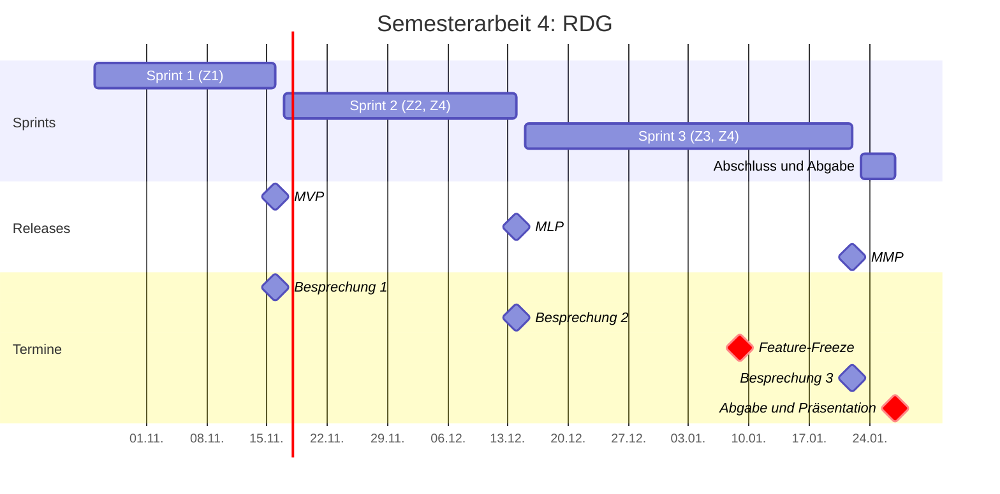
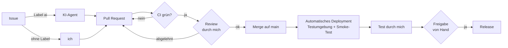

# Projektdokumentation

| | |
| :--- | :--- |
| Titel der Semesterarbeit | RDG als DevOps-Projekt mit KI-Wartung: Eine Pipeline, die GitHub-Issues selbst löst |
| Name | Dodoe Rumiñahui Mannale |
| Studiengang | Dipl. Informatiker/in HF, ITCNE25, TBZ |
| Semester / Abgabe | Semester 4 / 27.01.2027 |
| Themenfelder | Projektmanagement, DevOps |

Diese Projektdokumentation besteht aus **Teil A Projektmanagement** (Kapitel 1 bis 6) und **Teil B fachliche Umsetzung** (Kapitel 7 bis 13), gefolgt vom gemeinsamen **Anhang** (Kapitel 14). Sie wird während der Arbeit laufend ergänzt. Details liegen in den verlinkten Seiten dieser Doku, im [Kanban-Board](https://github.com/users/RuminahuiM/projects/1) und im Produkt-Repository [RuminahuiM/rdg](https://github.com/RuminahuiM/rdg).

!!! info "Stand 07.11.2026"
    Gerüst mit allen Kapiteln. Was schon feststeht, ist ausgefüllt. Kapitel mit dem Hinweis "Folgt" werden im genannten Sprint ergänzt.

## Inhaltsverzeichnis

**Teil A: Projektmanagement**

1. [Einleitung](#1-einleitung)
2. [Projektmethodik](#2-projektmethodik)
3. [Planung](#3-planung)
4. [Durchführung](#4-durchfuhrung)
5. [Risikomanagement](#5-risikomanagement)
6. [Reflexion Projektmanagement](#6-reflexion-projektmanagement)

**Teil B: Fachliche Umsetzung**

7. [Fachlicher Kontext und Theorie](#7-fachlicher-kontext-und-theorie)
8. [Anforderungen](#8-anforderungen)
9. [Architektur und Design](#9-architektur-und-design)
10. [Umsetzung](#10-umsetzung)
11. [Test und Qualitätssicherung](#11-test-und-qualitatssicherung)
12. [Ergebnis und Abnahme](#12-ergebnis-und-abnahme)
13. [Reflexion fachlich](#13-reflexion-fachlich)

**Anhang**

14. [Anhang und Verzeichnisse](#14-anhang-und-verzeichnisse)

## Zusammenfassung

!!! info "Folgt am Schluss"
    Kurze Zusammenfassung auf einer halben Seite: Ausgangslage, Vorgehen, wichtigste Ergebnisse pro Ziel, Fazit der KI-Auswertung.

---

## Teil A: Projektmanagement

## 1. Einleitung

### 1.1 Ausgangslage und Problemstellung

In Microsoft 365 gibt es dynamische Gruppen, die ihre Mitglieder automatisch nach Regeln füllen. In der Praxis reichen sie oft nicht: Viele Funktionen akzeptieren keine dynamischen Gruppen (z.B. mail-aktivierte Gruppen, Verteilerlisten oder gewisse Defender- und Exchange-Richtlinien), man kann Regel und manuelle Ausnahmen nicht mischen, und die Regel-Möglichkeiten sind begrenzt. Darum habe ich bei meiner Arbeit das Tool RDG (Real Dynamic Groups) gebaut. RDG wertet die Regeln selbst aus und schreibt das Resultat als normale Mitgliederliste in die Gruppe.

RDG ist bisher ein MVP. Es läuft in Azure und wird beim ersten Anwender getestet. Die Pipelines sind angelegt, aber nie richtig getestet, und das Deployment mache ich von Hand von meinem PC aus. Dazu kommt: Ich werde die Firma voraussichtlich bald verlassen, und danach pflegt niemand RDG weiter.

Ich möchte RDG darum als Open-Source-Projekt veröffentlichen, das möglichst wenig Wartung von Hand braucht. Zuerst setze ich es sauber als DevOps-Projekt auf. Danach probiere ich aus, wie gut ein KI-Agent bei der Wartung helfen kann, und werte das aus.

### 1.2 Project Summary

!!! info "Folgt am Schluss"
    Kurzer Überblick über das ganze Projekt: was gemacht wurde, mit welchen Mitteln, mit welchem Ergebnis.

### 1.3 Stakeholder

| Stakeholder | Rolle | Interesse |
| --- | --- | --- |
| Ich (Studierender) | Product Owner, Scrum Master, Developer | Erfolgreiche Semesterarbeit, RDG langfristig wartbar machen |
| Corrado Parisi | Experte Projektmanagement | Sauberes agiles Vorgehen, nachvollziehbare Planung und Steuerung |
| Fachexperte DevOps | Experte Fachliches Modul | Fachlich korrekte Umsetzung von CI/CD, Deployment und KI-Pipeline |
| Erster Anwender von RDG (mein Arbeitgeber) | Kunde | RDG weiter nutzen können, auch ohne mich |
| Open-Source-Community | spätere Nutzer und Mitwirkende | Verständliches, sicheres und gepflegtes Tool |

*Tabelle 1: Stakeholder*

### 1.4 Ziele (SMART)

| Ziel | Beschreibung | Messgrösse (Nachweis) | Termin | Umfang |
| --- | --- | --- | --- | --- |
| Z1 | Sauberes DevOps-Projekt: Repository mit Branching-Strategie, Kanban-Board, SemVer, Merge nur per Pull Request mit grüner CI | Ein absichtlich fehlerhafter Pull Request wird blockiert | 16.11.2026 | Must |
| Z2 | Automatisches Deployment in die Testumgebung (mit Smoke-Test) und Release-Freigabe von Hand | Mindestens 5 automatische Deployments, mindestens ein freigegebenes Release | 14.12.2026 | Must |
| Z3 | KI-Wartung als Versuch mit vier Issue-Arten | Auswertung von 8 Test-Issues: Ergebnis, eigener Aufwand, Dauer, Kosten | 22.01.2027 | Must (Durchführung und Auswertung) |
| Z4 | Die KI bleibt eingeschränkt: nur Pull Requests, kein Zugriff auf Umgebungen, nur meine Issues | Prompt-Injection-Test führt zu keiner unerlaubten Aktion | 22.01.2027 | Must |

*Tabelle 2: Ziele*

### 1.5 Scope und Abgrenzung

| In Scope | Out of Scope |
| --- | --- |
| RDG als DevOps-Projekt aufnehmen: Repository, Arbeitsregeln, Tests, Doku | Neue Funktionen von RDG selbst |
| Alle Pipelines (CI, Deployment, Release), auch die bestehenden | Kubernetes (Ausnahme für diese Arbeit, abgesprochen am 21.10.2026; folgt in der 5. Semesterarbeit) |
| KI-Pipeline für vier Issue-Arten mit Auswertung | Weitere Issue-Arten und ein KI-Helfer in der Web-App (optional) |
| Testumgebung in einem eigenen Test-Tenant | Änderungen an der produktiven Installation beim ersten Anwender |

*Tabelle 3: Scope*

## 2. Projektmethodik

### 2.1 Warum Scrum

!!! info "Folgt in Sprint 2"
    Begründung für Scrum statt Kanban oder Wasserfall in einem Solo-Projekt mit festen Besprechungsterminen.

### 2.2 Scrum in der Solo-Anwendung

Ich übernehme alle drei Verantwortlichkeiten (Product Owner, Scrum Master, Developer). Wie ich Events, Artefakte und die Grenzen der Solo-Anwendung handhabe, steht im [Scrum-Setup](projekt/scrum-setup.md).

### 2.3 User Stories, Akzeptanzkriterien, Definition of Ready und Done

Jede Story ist ein Issue mit Akzeptanzkriterien als Checkliste. Ein Item wechselt im Board erst von Backlog zu ToDo, wenn es die Definition of Ready erfüllt. Definition of Ready und Definition of Done stehen im [Scrum-Setup](projekt/scrum-setup.md#definition-of-ready).

### 2.4 Schätzung und Priorisierung

Schätzung mit Story Points nach Fibonacci, Priorisierung nach MoSCoW (Labels `must`, `should`, `could`, `wont`).

### 2.5 Werkzeuge

| Werkzeug | Wofür |
| --- | --- |
| GitHub Projects | Kanban-Board, Product Backlog, Sprint-Übersicht |
| GitHub (zwei Repositories) | Produkt-Code (`rdg`) und Projektdokumentation (`rdg-semesterarbeit`) |
| GitHub Actions | CI, Deployment, Release, KI-Pipeline, Veröffentlichung dieser Doku |
| GitHub Pages mit Material for MkDocs | Veröffentlichung dieser Dokumentation |
| MS Teams | Kommunikation mit den Experten |
| Claude (Anthropic) | KI-Agent in der Pipeline (Gegenstand der Arbeit) und KI-Assistent bei der Arbeit (siehe [Deklaration](#141-deklaration-der-ki-nutzung)) |

*Tabelle 4: Werkzeuge*

### 2.6 Arbeiten mit KI-Unterstützung

!!! info "Folgt in Sprint 2"
    Wie ich KI als Assistent einsetze, wie ich die Ergebnisse prüfe und wie ich den Zeitgewinn messe.

## 3. Planung

### 3.1 Roadmap und Releases

| Release | Ende | Was der Release bringt |
| --- | --- | --- |
| MVP | Sprint 1, 16.11.2026 | RDG liegt sauber auf GitHub, Board steht, Branch-Schutz aktiv, CI-Pipeline grün (Z1) |
| MLP | Sprint 2, 14.12.2026 | Automatisches Deployment in die Testumgebung, Release nur nach Freigabe (Z2), erste KI-Pipeline mit Sicherheitsregeln (Z4) |
| MMP | Sprint 3, 22.01.2027 | KI-Pipeline für vier Issue-Arten, 8 Test-Issues ausgewertet, Prompt-Injection-Test (Z3, Z4) |

*Tabelle 5: Releases*

### 3.2 Gantt-Chart

*Abbildung 1: Gantt-Chart mit Sprints, Releases und Terminen*

Ab dem **Feature-Freeze am 09.01.2027** kommen keine neuen Funktionen mehr dazu. Die Zeit bis zur Abgabe ist für Tests, Fehlerbehebung, Auswertung und Dokumentation reserviert.

### 3.3 Product Backlog

Der Backlog liegt im [Kanban-Board](https://github.com/users/RuminahuiM/projects/1). Pro Ziel gibt es ein Epic, die Stories hängen als Unter-Issues daran.

| Epic | Kürzel | Ziel |
| --- | --- | --- |
| Projektmanagement und Kommunikation | PM | |
| Sauberes DevOps-Projekt | CI | Z1 |
| Automatisches Deployment und Release-Freigabe | DEP | Z2 |
| Die KI bleibt eingeschränkt | SEC | Z4 |
| KI-Wartung als Versuch | AI | Z3 |
| Dokumentation und Abschluss | DOC | |

*Tabelle 6: Epics*

### 3.4 Kapazität

Gearbeitet wird am Wochenende (je ca. 4 bis 6 h) und an einem Abend unter der Woche (ca. 2 bis 3 h). Pro Sprint plane ich ca. 20 Prozent Reserve ein. Die TBZ gibt ca. 50 Stunden als Richtwert vor.

### 3.5 SWOT-Analyse

| | Hilfreich | Hinderlich |
| --- | --- | --- |
| **Intern** | **Stärken:** RDG existiert als funktionierendes MVP mit Tests, Mocks und Pipelines; ich kenne das Tool und das Umfeld genau | **Schwächen:** Solo-Projekt ohne Code-Review durch eine zweite Person; begrenzte Zeit neben Beruf und Schule |
| **Extern** | **Chancen:** KI-Agenten in CI/CD sind 2026 verfügbar und gut dokumentiert; Open Source macht RDG für andere nutzbar | **Risiken:** KI-Ergebnisse schwer vorhersehbar; Test-Tenant und Azure kosten Geld; Abhängigkeit von externen Diensten (GitHub, Azure, Anthropic) |

*Tabelle 7: SWOT-Analyse (Stand 07.11.2026)*

## 4. Durchführung

### 4.1 Sprint 1: Sauberes DevOps-Projekt

!!! info "Folgt nach Sprint 1"
    Ziel, Ergebnis, abgeschlossene Stories, Velocity, Abweichungen. Details im [Sprint 1](sprints/sprint-1/planning.md).

### 4.2 Sprint 2: Deployment, Release und erste KI-Pipeline

!!! info "Folgt nach Sprint 2"

### 4.3 Sprint 3: KI-Wartung als Versuch

!!! info "Folgt nach Sprint 3"

### 4.4 Fortschritt: Velocity und Burn-up

!!! info "Folgt ab Sprint 1"
    Geplante und erledigte Story Points pro Sprint, Burn-up-Chart aus dem Board.

### 4.5 Kommunikation mit den Experten

| Datum | Mit | Thema | Ergebnis |
| --- | --- | --- | --- |
| 21.10.2026 | Thanam Pangri, Marcel Bernet | Kubernetes-Vorgabe | Ausnahme für diese Arbeit |
| 07.11.2026 | Corrado Parisi | Feedback zum Einreichungsformular | Formular überarbeitet (Version 2) |

*Tabelle 8: Abstimmungen mit den Experten*

Weitere Details unter [Besprechungen](besprechungen/index.md).

## 5. Risikomanagement

### 5.1 Methodik

Risiken werden nach Wahrscheinlichkeit und Auswirkung (je 1 bis 3) bewertet, der Score ist das Produkt. Ab Score 4 wird ein Risiko aktiv beobachtet, ab Score 6 hat es hohe Priorität. Jedes Risiko hat eine vorbeugende Massnahme und einen Plan B. Das ganze Register steht im [Risk Register](projekt/risk-register.md).

### 5.2 Wichtigste Risiken und Massnahmen

| ID | Risiko | Score | Massnahme |
| --- | --- | --- | --- |
| R-T01 | Die KI macht falsche Änderungen | 6 | CI-Pipeline, Prüfung jedes Pull Requests, Test vor dem Release |
| R-T02 | Prompt Injection oder zu viele Rechte für den Agenten | 6 | Nur meine Issues, minimale Rechte, kein Zugriff auf Umgebungen, eigener Test |
| R-K01 | Der KI-Teil ist schwieriger als gedacht | 6 | Z1 und Z2 zuerst, vier klar begrenzte Issue-Arten |
| R-E01 | Testumgebung nicht rechtzeitig verfügbar | 6 | Test-Tenant zu Beginn von Sprint 2, Mocks als Plan B |
| R-S01 | Sprints laufen über | 6 | 20 Prozent Reserve, MoSCoW, Should- und Could-Stories zuerst streichen |
| R-S02 | Zu wenig Zeit für Doku am Schluss | 6 | Feature-Freeze 09.01.2027, Doku laufend in jedem Sprint |

*Tabelle 9: Risiken mit hoher Priorität (Stand 07.11.2026)*

### 5.3 Eingetretene Risiken und Reaktion

!!! info "Folgt laufend"

## 6. Reflexion Projektmanagement

### 6.1 Solo-Scrum: was trug und was fehlte

!!! info "Folgt am Schluss"

### 6.2 Planung, Schätzung und Zeit

!!! info "Folgt am Schluss"

### 6.3 Handlungsempfehlungen

!!! info "Folgt am Schluss"

---

## Teil B: Fachliche Umsetzung

## 7. Fachlicher Kontext und Theorie

!!! info "Folgt in Sprint 2"
    Theorie aus dem DevOps-Unterricht, jeweils mit Bezug zu RDG.

### 7.1 RDG kurz erklärt

### 7.2 DevOps, CI/CD und Continuous Delivery

### 7.3 GitHub Flow, Conventional Commits und SemVer

### 7.4 Infrastructure as Code mit OpenTofu

### 7.5 KI-Agenten in der Softwarewartung

### 7.6 Sicherheit: Least Privilege, OIDC und Prompt Injection

## 8. Anforderungen

!!! info "Folgt in Sprint 1 und 2"
    Funktionale und nicht-funktionale Anforderungen an Pipelines und KI-Pipeline, abgeleitet aus den Zielen Z1 bis Z4.

### 8.1 Funktionale Anforderungen

### 8.2 Nicht-funktionale Anforderungen

## 9. Architektur und Design

### 9.1 Ausgangslage: Architektur von RDG

RDG läuft vollständig in einer Azure-Ressourcengruppe im Tenant des Anwenders.

*Abbildung 2: Komponenten von RDG (vereinfacht)*

Die API und die Runbooks verwenden dasselbe Engine-Modul. Darum liefern die Vorschau in der Web-App und der echte Sync dieselben Resultate.

### 9.2 Ablauf von der Änderung bis zum Release

*Abbildung 3: Ablauf vom Issue bis zum Release*

Ich prüfe zweimal: den Code vor dem Merge und die laufende Version vor dem Release.

### 9.3 Schnittstellen und Einflussgrössen

| Schnittstelle | Wofür | Einfluss auf das Projekt |
| --- | --- | --- |
| GitHub (Repos, Actions, Projects, Pages) | Code, Pipelines, Board, Doku | Zentrale Plattform, Limits des Free-Plans |
| Microsoft Azure | Testumgebung von RDG | Kosten (ca. 27 USD pro Monat), Login aus der Pipeline per OIDC |
| Microsoft-365-Test-Tenant | Gruppen und Benutzer für Tests | Muss zuerst eingerichtet werden (Sprint 2) |
| Anthropic API (Claude) | KI-Agent in der Pipeline | Kosten pro Durchlauf, Qualität der Ergebnisse |
| Experten und Teams-Kanal | Feedback, Freigaben | Feste Besprechungstermine bestimmen die Sprint-Längen |

*Tabelle 10: Schnittstellen und Einflussgrössen*

### 9.4 Evaluation der Lösungsansätze

Wichtige Entscheidungen werden im RDG-Repository als Architecture Decision Record (ADR) festgehalten, mit Varianten, Kriterien und Begründung.

| Entscheidung | Varianten | Entscheid | ADR |
| --- | --- | --- | --- |
| Plattform für das automatische Deployment | GitHub Actions, Azure DevOps | GitHub Actions | folgt in Sprint 2 |
| Branching-Strategie | GitHub Flow, Git Flow, Trunk-based | folgt | folgt in Sprint 1 (CI-3) |
| Lizenz | MIT, Apache-2.0, GPL-3.0 | folgt | folgt in Sprint 1 (CI-1) |
| Login aus der Pipeline nach Azure | OIDC, Client-Secret | folgt | folgt in Sprint 2 (DEP-3) |
| KI-Agent in der Pipeline | Claude Code in GitHub Actions, andere Agenten | folgt | folgt in Sprint 2 |

*Tabelle 11: Entscheidungen und Varianten*

### 9.5 Compliance und rechtliche Aspekte

!!! info "Folgt in Sprint 1 und 2"
    Open-Source-Lizenz, Datenschutz (keine Personendaten an die KI, keine echten Tenant-Daten in den Repositories), Umgang mit KI-generiertem Code.

## 10. Umsetzung

!!! info "Folgt pro Sprint"
    Pro Teil: was umgesetzt wurde, wichtige Code- oder Konfigurationsausschnitte, Screenshots.

### 10.1 Repository und Arbeitsregeln (Z1)

### 10.2 CI-Pipeline (Z1)

### 10.3 Deployment und Release (Z2)

### 10.4 KI-Pipeline (Z3)

### 10.5 Sicherheitsrahmen für den Agenten (Z4)

## 11. Test und Qualitätssicherung

### 11.1 Teststrategie

!!! info "Folgt in Sprint 1"

### 11.2 Testprotokoll

Testfälle und Ergebnisse stehen im [Testprotokoll](nachweise/testprotokoll.md).

### 11.3 Nachweise pro Ziel

| Ziel | Nachweis | Ort |
| --- | --- | --- |
| Z1 | Fehlerhafter Pull Request wird blockiert | [Testprotokoll](nachweise/testprotokoll.md) |
| Z2 | 5 automatische Deployments, 1 freigegebenes Release | [Testprotokoll](nachweise/testprotokoll.md) |
| Z3 | Auswertung der 8 Test-Issues | [KI-Auswertung](nachweise/ki-auswertung.md) |
| Z4 | Prompt-Injection-Test | [Testprotokoll](nachweise/testprotokoll.md) |

*Tabelle 12: Nachweise pro Ziel*

## 12. Ergebnis und Abnahme

### 12.1 Zielerreichung

| Ziel | Erreicht | Nachweis | Bemerkung |
| --- | --- | --- | --- |
| Z1 | offen | | |
| Z2 | offen | | |
| Z3 | offen | | |
| Z4 | offen | | |

*Tabelle 13: Zielerreichung*

### 12.2 Auswertung der KI-Wartung

!!! info "Folgt in Sprint 3"
    Zusammenfassung der [KI-Auswertung](nachweise/ki-auswertung.md): was die KI kann, wo sie scheitert, wie viel Aufwand für mich bleibt.

### 12.3 Installation und Inbetriebnahme

!!! info "Folgt in Sprint 2"
    Wie die Testumgebung aufgesetzt wird und wie die Pipelines eingerichtet werden. Verweis auf den Install Guide im RDG-Repository.

### 12.4 Übergabe und offene Punkte

!!! info "Folgt am Schluss"

## 13. Reflexion fachlich

!!! info "Folgt am Schluss"

### 13.1 Vorbehalte gegenüber der eigenen Lösung

### 13.2 Erkenntnisse

### 13.3 Handlungsempfehlungen für das weitere Vorgehen

---

## Anhang

## 14. Anhang und Verzeichnisse

### 14.1 Deklaration der KI-Nutzung

!!! info "Wird laufend ergänzt"
    Für Recherche, Texte und Code habe ich Claude (Anthropic) als Assistenten eingesetzt. Alle Ergebnisse habe ich geprüft und verantworte sie selbst. Übernommene fremde Texte und Code-Teile sind im Text mit Quelle gekennzeichnet.

### 14.2 Repository-Navigation und Setup

| Was | Wo |
| --- | --- |
| Produkt-Code von RDG | [github.com/RuminahuiM/rdg](https://github.com/RuminahuiM/rdg) |
| Installationsanleitung RDG | `docs/guides/20-install-guide.md` im RDG-Repository |
| Diese Dokumentation | [github.com/RuminahuiM/rdg-semesterarbeit](https://github.com/RuminahuiM/rdg-semesterarbeit), lokal ansehen mit `pip install -r requirements.txt` und `mkdocs serve` |
| Kanban-Board | [GitHub Projects](https://github.com/users/RuminahuiM/projects/1) |

*Tabelle 14: Repository-Navigation*

### 14.3 Quellenverzeichnis

Siehe [Quellen](anhang/quellen.md).

### 14.4 Glossar

Siehe [Glossar](anhang/glossar.md).

### 14.5 Abbildungsverzeichnis

| Nr. | Abbildung | Kapitel |
| --- | --- | --- |
| 1 | Gantt-Chart mit Sprints, Releases und Terminen | [3.2](#32-gantt-chart) |
| 2 | Komponenten von RDG (vereinfacht) | [9.1](#91-ausgangslage-architektur-von-rdg) |
| 3 | Ablauf vom Issue bis zum Release | [9.2](#92-ablauf-von-der-anderung-bis-zum-release) |

### 14.6 Tabellenverzeichnis

| Nr. | Tabelle | Kapitel |
| --- | --- | --- |
| 1 | Stakeholder | [1.3](#13-stakeholder) |
| 2 | Ziele | [1.4](#14-ziele-smart) |
| 3 | Scope | [1.5](#15-scope-und-abgrenzung) |
| 4 | Werkzeuge | [2.5](#25-werkzeuge) |
| 5 | Releases | [3.1](#31-roadmap-und-releases) |
| 6 | Epics | [3.3](#33-product-backlog) |
| 7 | SWOT-Analyse | [3.5](#35-swot-analyse) |
| 8 | Abstimmungen mit den Experten | [4.5](#45-kommunikation-mit-den-experten) |
| 9 | Risiken mit hoher Priorität | [5.2](#52-wichtigste-risiken-und-massnahmen) |
| 10 | Schnittstellen und Einflussgrössen | [9.3](#93-schnittstellen-und-einflussgrossen) |
| 11 | Entscheidungen und Varianten | [9.4](#94-evaluation-der-losungsansatze) |
| 12 | Nachweise pro Ziel | [11.3](#113-nachweise-pro-ziel) |
| 13 | Zielerreichung | [12.1](#121-zielerreichung) |
| 14 | Repository-Navigation | [14.2](#142-repository-navigation-und-setup) |
